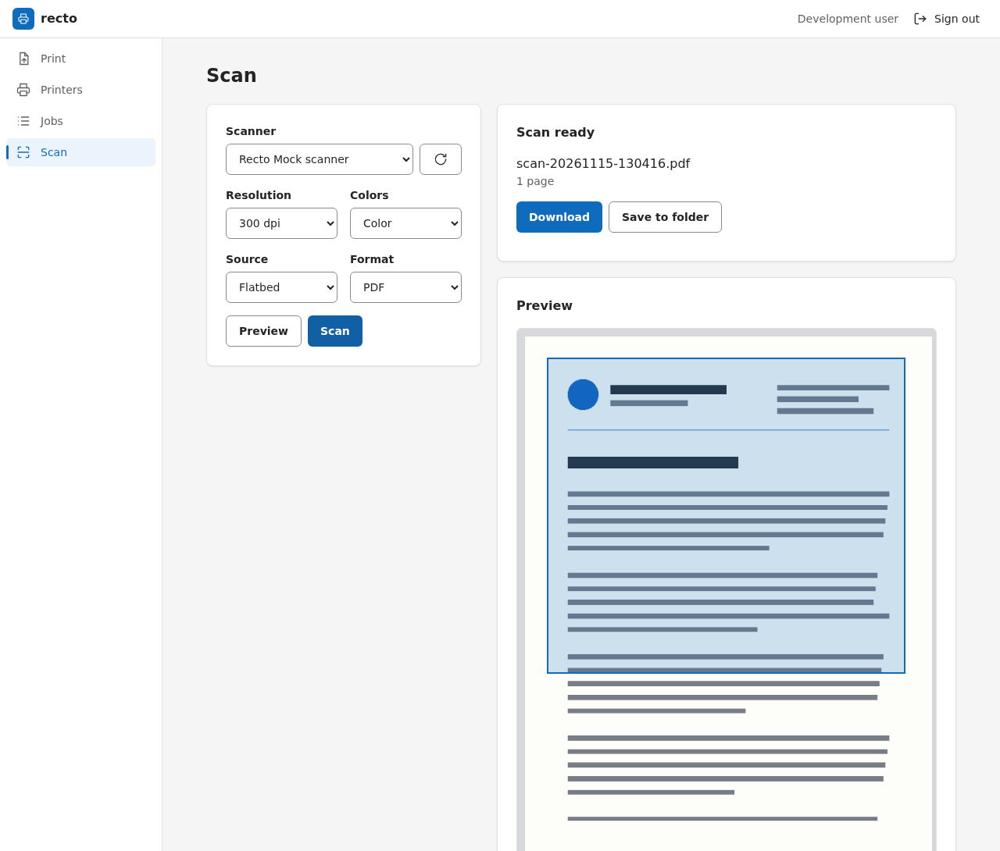
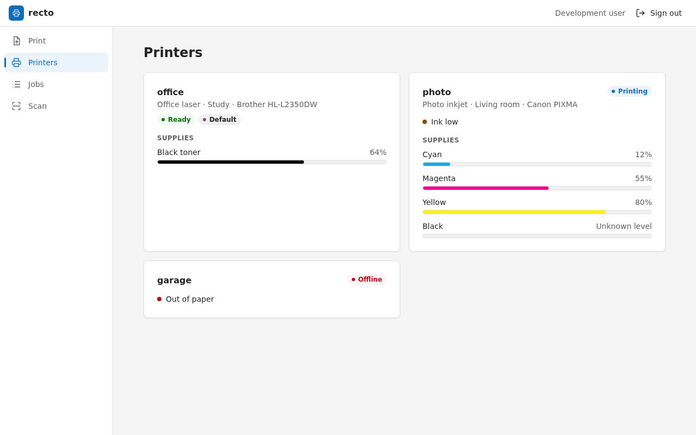

<h1 align="center">recto</h1>

<p align="center">
  <strong>The self-hosted print and scan server for your home and small office.</strong><br>
  Print and scan from any browser, phone or computer, with no driver: a web app and an
  AirPrint, IPP Everywhere and eSCL server on top of CUPS and SANE, in one small container.
</p>

<p align="center">
  <a href="https://github.com/AlixANNERAUD/recto/actions/workflows/ci.yml"></a>
  <a href="https://codecov.io/github/AlixANNERAUD/recto"></a>
  <a href="https://alixanneraud.github.io/recto/"></a>
  <a href="LICENSE"></a>
</p>

---

recto gives everyone in the house or the office one place to **print** on any CUPS printer and
**scan** from any SANE scanner: a web page for phones and laptops, and a **driverless network
printer and scanner** that macOS, Windows, Linux, iPhone, iPad and Android add from their own
Print dialog and scan apps. Scans land in a download or straight in a folder such as the consume
folder of [Paperless-ngx](https://docs.paperless-ngx.com). People sign in with **local accounts**
or your own **OpenID Connect** provider (Zitadel, Keycloak, Authentik and others), and
administrators can put **prices and quotas** on printers and see who printed and scanned what.

It is built for homelabs, families, associations and small offices that want an AirPrint server,
a web scanner and simple print accounting without running a print management suite: a
lightweight, self-hosted alternative to sharing printers from a desktop, and to commercial print
management for a handful of printers.

<p align="center">
  <picture>
    <source media="(prefers-color-scheme: dark)" srcset="docs/src/images/scan-dark.png">
    
  </picture>
</p>

<p align="center">
  <picture>
    <source media="(prefers-color-scheme: dark)" srcset="docs/src/images/print-dark.png">
    
  </picture>
  <picture>
    <source media="(prefers-color-scheme: dark)" srcset="docs/src/images/printers-dark.png">
    
  </picture>
</p>

## What you get

**Print from anywhere**
- Print PDF, JPEG and PNG from the web page on any CUPS printer, with copies, two-sided, color
  and page ranges. Printing works without JavaScript.
- Add recto as a printer on **macOS, Windows, Linux, iOS and Android**, with no driver: it speaks
  IPP Everywhere and AirPrint, and announces itself over DNS-SD (Bonjour) on the local network.
  Each device gets a password of its own, revocable at any time.
- Documents from devices wait on the Jobs page until their owner picks the printer (a secure
  print release, so nothing sits in the tray of the wrong printer), or print at once on the
  printer they chose.
- Each printer's state, supply levels and errors, and the print queue, where jobs can be
  cancelled. Administrators add, pause and remove printers from the web page.

**Scan straight to your documents**
- Scan from network scanners (eSCL/AirScan and WSD, through sane-airscan, so most recent
  Brother, Canon, Epson and HP models), scanners shared by `saned`, and USB scanners.
- Choose resolution, colors, source and format (PDF, PNG, JPEG), preview the glass and drag to
  scan only part of it. Feeder batches become one PDF.
- Save into a folder for Paperless-ngx or any folder watcher: files appear complete and never
  overwrite one another.
- Scan from the computer too: recto is an eSCL scanner for macOS Image Capture, Windows and
  Mopria scan apps.

**Keep printing under control**
- Prices per printer, by black-and-white page, color page and sheet: every job records what it
  cost, and jobs that never printed are refunded.
- Quotas on pages, sheets, color pages, jobs or money, per day, week, month, quarter or year,
  for everyone, each member of a group, one user or a shared pool, with grants on top.
- Usage reports: who printed and scanned what over a range of days, by user, group, printer or
  scanner, with CSV exports for a spreadsheet.
- Printers and scanners limited to groups, and jobs kept private to their owner.

**Fits your home server**
- One container for amd64 and arm64, configured with environment variables only, running as
  non-root on a read-only file system, next to a locked-down CUPS server.
- Accounts and history in a **SQLite** file on a volume, or in **PostgreSQL**; `recto backup`
  copies SQLite while it runs.
- Local accounts with passwords hashed with Argon2id and rate-limited sign-in, and single
  sign-on with any OpenID Connect provider, with administrators and groups read from its claims.
- Ready for your reverse proxy, with example files for nginx, Caddy, Traefik, Apache, HAProxy
  and Cloudflare Tunnel.
- Your brand (name, accent color, logo, icon), light and dark themes, made for phones, and
  installable as an app.

## Quick start

You need Docker with Compose.

```sh
git clone https://github.com/AlixANNERAUD/recto && cd recto
mkdir -p consume && sudo chown 65532:65532 consume
echo 'RECTO_PUBLIC_URL=https://recto.example.org' > .env
docker compose up -d --wait
docker compose exec recto /app/recto create-administrator --username admin
```

This starts recto on port 8080 and a locked-down CUPS server next to it, then creates an
administrator with the password the command asks for; the administrator creates the other
accounts from the web page. To sign in with your identity provider too,
[set up single sign-on](https://alixanneraud.github.io/recto/how-to/sign-in.html). Sign in as
the administrator and add a printer under **Administration > Printers** with its address, such as
`ipp://192.168.1.60/ipp/print`, or from the command line:

```sh
docker compose exec cups lpadmin -p office -E -v ipp://192.168.1.60/ipp/print -m everywhere
```

Then [add a scanner](https://alixanneraud.github.io/recto/how-to/add-scanner.html) and
add recto to your computers and phones ([macOS](https://alixanneraud.github.io/recto/how-to/print-from-macos.html),
[Windows](https://alixanneraud.github.io/recto/how-to/print-from-windows.html),
[Linux](https://alixanneraud.github.io/recto/how-to/print-from-linux.html),
[iPhone and iPad](https://alixanneraud.github.io/recto/how-to/print-from-ios.html),
[Android](https://alixanneraud.github.io/recto/how-to/print-from-android.html)).

### Behind a reverse proxy

recto serves plain HTTP on port 8080: put a reverse proxy with TLS in front of it. The
[reverse proxy guide](https://alixanneraud.github.io/recto/how-to/reverse-proxy.html) covers what
every proxy must pass through (long scans, uploads, printing from devices, the client address
for sign-in limits), and [`examples/proxy`](examples/proxy) has a working file for each:

| Proxy | Guide | Example |
| --- | --- | --- |
| nginx | [Setup](https://alixanneraud.github.io/recto/how-to/reverse-proxy.html#nginx) | [`nginx/recto.conf`](examples/proxy/nginx/recto.conf) |
| Caddy | [Setup](https://alixanneraud.github.io/recto/how-to/reverse-proxy.html#caddy) | [`caddy/Caddyfile`](examples/proxy/caddy/Caddyfile) |
| Traefik | [Setup](https://alixanneraud.github.io/recto/how-to/reverse-proxy.html#traefik) | [`traefik/compose.traefik.yml`](examples/proxy/traefik/compose.traefik.yml) |
| Apache | [Setup](https://alixanneraud.github.io/recto/how-to/reverse-proxy.html#apache) | [`apache/recto.conf`](examples/proxy/apache/recto.conf) |
| HAProxy | [Setup](https://alixanneraud.github.io/recto/how-to/reverse-proxy.html#haproxy) | [`haproxy/haproxy.cfg`](examples/proxy/haproxy/haproxy.cfg) |
| Cloudflare Tunnel | [Setup](https://alixanneraud.github.io/recto/how-to/reverse-proxy.html#cloudflare-tunnel) | [`cloudflared/config.yml`](examples/proxy/cloudflared/config.yml) |

Images are published as `ghcr.io/alixanneraud/recto` and `alixanneraud/recto` on Docker Hub, for
amd64 and arm64. To run your own changes, build from the checkout with
`docker compose up -d --wait --build`.

## Documentation

The full guide lives at **<https://alixanneraud.github.io/recto/>**:

- **Tutorial** - [your first print and scan](https://alixanneraud.github.io/recto/tutorials/first-print-and-scan.html), with a
  virtual printer and scanner, no hardware or identity provider needed.
- **How-to guides** - [install](https://alixanneraud.github.io/recto/how-to/install.html),
  [manage users](https://alixanneraud.github.io/recto/how-to/manage-users.html),
  [single sign-on](https://alixanneraud.github.io/recto/how-to/sign-in.html) with Zitadel, Keycloak or Authentik,
  [add a printer](https://alixanneraud.github.io/recto/how-to/add-printer.html),
  [add a scanner](https://alixanneraud.github.io/recto/how-to/add-scanner.html),
  [let devices find recto](https://alixanneraud.github.io/recto/how-to/discovery.html),
  [set prices](https://alixanneraud.github.io/recto/how-to/set-prices.html) and [quotas](https://alixanneraud.github.io/recto/how-to/set-quotas.html),
  [see usage](https://alixanneraud.github.io/recto/how-to/see-usage.html),
  [save into Paperless-ngx](https://alixanneraud.github.io/recto/how-to/paperless.html),
  [reverse proxy](https://alixanneraud.github.io/recto/how-to/reverse-proxy.html),
  [PostgreSQL](https://alixanneraud.github.io/recto/how-to/postgresql.html),
  [back up](https://alixanneraud.github.io/recto/how-to/back-up.html), [upgrade](https://alixanneraud.github.io/recto/how-to/upgrade.html),
  [troubleshoot](https://alixanneraud.github.io/recto/how-to/troubleshoot.html), ...
- **Reference** - [configuration](https://alixanneraud.github.io/recto/reference/configuration.html),
  [command line](https://alixanneraud.github.io/recto/reference/command-line.html),
  [printing](https://alixanneraud.github.io/recto/reference/printing.html), [scanning](https://alixanneraud.github.io/recto/reference/scanning.html),
  [quotas](https://alixanneraud.github.io/recto/reference/quotas.html), [reports](https://alixanneraud.github.io/recto/reference/reports.html),
  [container image](https://alixanneraud.github.io/recto/reference/container-image.html).
- **Explanation** - [how recto works](https://alixanneraud.github.io/recto/explanation/architecture.html),
  [printing from devices](https://alixanneraud.github.io/recto/explanation/devices.html),
  [how quotas work](https://alixanneraud.github.io/recto/explanation/quotas.html),
  [security model](https://alixanneraud.github.io/recto/explanation/security.html).

Its source is in [`docs/`](docs/src/SUMMARY.md).

## Is recto for you?

Choose recto if a few printers and scanners should be usable by everyone in the house or the
office, from any device and without drivers, behind a sign-in, with the scans going to
Paperless-ngx and, if you want, a price and a limit on what is printed.

recto is not a print driver: CUPS prints and SANE scans, so a printer or scanner they do not
support is out of reach. It is not built for hundreds of printers, card readers at the printer
or billing across sites; larger print management suites cover those. See the
[issues](https://github.com/AlixANNERAUD/recto/issues) for what is planned next.

## Development

You need [mise](https://mise.jdx.dev), plus `libsane-dev` and libclang
(`apt install libsane-dev libclang-dev pkg-config`).

```sh
mise install
mise run dev     # http://127.0.0.1:3000, signed in, with fake printers and scanners
mise run check   # what CI runs: rustfmt, clippy, rustdoc, tests, cargo-deny
```

See [Develop and contribute](https://alixanneraud.github.io/recto/how-to/develop.html) and
`AGENTS.md`.

## Contributing

Issues and pull requests are welcome; commits follow
[Conventional Commits](https://www.conventionalcommits.org), from which releases and the
changelog are made. See [develop and contribute](https://alixanneraud.github.io/recto/how-to/develop.html)
and [RELEASING.md](RELEASING.md).

## Licence

[Apache-2.0](LICENSE).
