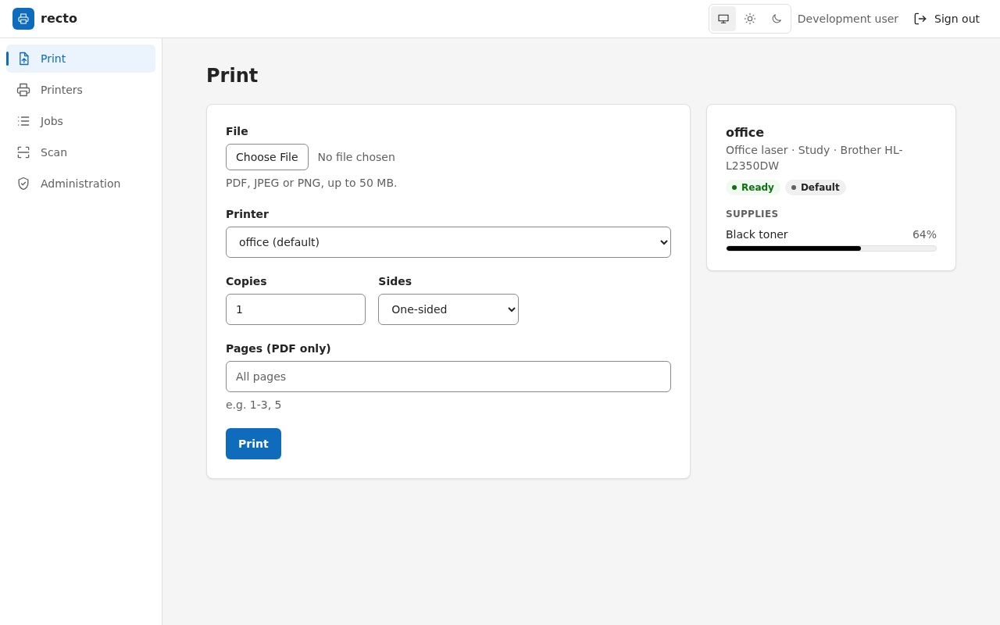

<h1 align="center">recto</h1>

<p align="center">
  <strong>Print and scan from any browser, through your home server.</strong><br>
  A small self-hosted web app for CUPS and SANE, with local accounts or your OpenID Connect sign-in.
</p>

<p align="center">
  <a href="https://github.com/AlixANNERAUD/recto/actions/workflows/ci.yml"></a>
  <a href="https://codecov.io/github/AlixANNERAUD/recto"></a>
  <a href="https://alixanneraud.github.io/recto/"></a>
  <a href="LICENSE"></a>
</p>

---

recto gives everyone in the house one page to **print** a file on any CUPS printer and to **scan**
from any SANE scanner, from a phone or a laptop, with no driver to install. Scans can be
downloaded or saved straight into a folder such as the consume folder of
[Paperless-ngx](https://docs.paperless-ngx.com). People sign in with **local accounts** that an
administrator creates, or through your own **OpenID Connect** provider (Zitadel, Keycloak,
Authentik and others), or both.

<p align="center">
  <picture>
    <source media="(prefers-color-scheme: dark)" srcset="docs/src/images/scan-dark.png">
    
  </picture>
</p>

<p align="center">
  <picture>
    <source media="(prefers-color-scheme: dark)" srcset="docs/src/images/print-dark.png">
    
  </picture>
  <picture>
    <source media="(prefers-color-scheme: dark)" srcset="docs/src/images/printers-dark.png">
    
  </picture>
</p>

## Features

- **Print** PDF, JPEG and PNG on any CUPS printer, with copies, two-sided, color and page ranges.
  See each printer's state, supply levels and errors, and the print queue, where any job can be
  cancelled. Printing works without JavaScript.
- **Scan** from network scanners (eSCL/AirScan and WSD, through sane-airscan), scanners shared by
  `saned`, and USB scanners. Choose resolution, colors, source and format (PDF, PNG, JPEG),
  preview the glass and drag to scan only part of it. Feeder batches become one PDF.
- **Save to a folder** for Paperless-ngx or any folder watcher: files appear complete, and never
  overwrite one another.
- **Local accounts** with passwords hashed with Argon2id and rate-limited sign-in, created by
  **administrators** who also reset passwords and disable users from the web page.
- **Single sign-on** with any OpenID Connect provider, optionally limited to a role or group, with
  administrators and groups read from the provider's claims.
- **Your brand**: set the name, accent color, logo and icon; each person picks light, dark or
  the device's theme.
- **One small container**, configured with environment variables only, running as non-root with a
  read-only file system, for amd64 and arm64. Accounts and sessions live in a **SQLite** file on a
  volume, or in **PostgreSQL**; `recto backup` copies SQLite while it runs.
- **Works on phones**, in light and dark mode, and installs as an app on phones and computers.

## Quick start

You need Docker with Compose.

```sh
git clone https://github.com/AlixANNERAUD/recto && cd recto
mkdir -p consume && sudo chown 65532:65532 consume
echo 'RECTO_PUBLIC_URL=https://recto.example.org' > .env
docker compose up -d --wait
docker compose exec recto /app/recto create-administrator --username admin
```

This starts recto on port 8080 and a locked-down CUPS server next to it, then creates an
administrator with the password the command asks for; the administrator creates the other
accounts from the web page. To sign in with your identity provider too,
[set up single sign-on](https://alixanneraud.github.io/recto/how-to/sign-in.html). Add a printer:

```sh
docker compose exec cups lpadmin -p office -E -v ipp://192.168.1.60/ipp/print -m everywhere
```

Then [add a scanner](https://alixanneraud.github.io/recto/how-to/add-scanner.html) and put recto
[behind your reverse proxy](https://alixanneraud.github.io/recto/how-to/reverse-proxy.html)
(example files for nginx, Caddy, Traefik, Apache, HAProxy and Cloudflare Tunnel are in
[`examples/proxy`](examples/proxy)).

Images are published as `ghcr.io/alixanneraud/recto` once a release exists; until then, build
from the checkout with `docker compose up -d --wait --build`.

## Documentation

The [guide](https://alixanneraud.github.io/recto/) has:

- a [tutorial](https://alixanneraud.github.io/recto/tutorials/first-print-and-scan.html) that runs
  recto with a virtual printer and scanner, no hardware or identity provider needed;
- how-to guides to [install](https://alixanneraud.github.io/recto/how-to/install.html),
  [manage users](https://alixanneraud.github.io/recto/how-to/manage-users.html),
  [set up single sign-on](https://alixanneraud.github.io/recto/how-to/sign-in.html) with Zitadel,
  Keycloak or Authentik, [add printers](https://alixanneraud.github.io/recto/how-to/add-printer.html)
  and [scanners](https://alixanneraud.github.io/recto/how-to/add-scanner.html),
  [save into Paperless-ngx](https://alixanneraud.github.io/recto/how-to/paperless.html),
  [back up](https://alixanneraud.github.io/recto/how-to/back-up.html) and
  [troubleshoot](https://alixanneraud.github.io/recto/how-to/troubleshoot.html);
- the [configuration reference](https://alixanneraud.github.io/recto/reference/configuration.html)
  and everything else to look up;
- explanations of [how recto works](https://alixanneraud.github.io/recto/explanation/architecture.html)
  and its [security model](https://alixanneraud.github.io/recto/explanation/security.html).

Its source is in [`docs/`](docs/src/SUMMARY.md).

## Development

You need [mise](https://mise.jdx.dev), plus `libsane-dev` and libclang
(`apt install libsane-dev libclang-dev pkg-config`).

```sh
mise install
mise run dev     # http://127.0.0.1:3000, signed in, with fake printers and scanners
mise run check   # what CI runs: rustfmt, clippy, rustdoc, tests, cargo-deny
```

See [Develop and contribute](https://alixanneraud.github.io/recto/how-to/develop.html) and
`AGENTS.md`.

## Licence

[Apache-2.0](LICENSE).
