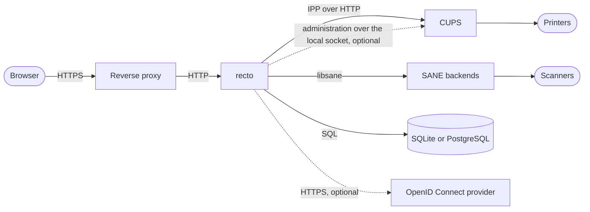

# How recto works

recto is a web layer. The hard parts of printing and scanning, drivers, page description
languages and device protocols, are left to two mature projects: CUPS and SANE. recto turns them
into one web page anyone in the house can open, behind a sign-in.

## Printing: an IPP client of CUPS

CUPS speaks IPP, the Internet Printing Protocol, which is HTTP carrying binary requests. recto is
an IPP client, like the print dialog of a desktop. It asks CUPS for its printers and their
attributes (state, supported options, supply levels), sends documents with `Print-Job`, lists jobs
with `Get-Jobs` and cancels them with `Cancel-Job`.

recto sends PDF, JPEG and PNG as they are. CUPS converts them for each printer with its filters,
which is why recto needs no drivers and no conversion of its own. The options shown on the Print
page are the ones CUPS says the printer supports, so a printer without two-sided printing shows
no Sides field.

CUPS runs in its own container, with its spool and its printers in volumes. recto keeps nothing
about printers but who may use them: every page load asks CUPS.

Adding and managing printers is a separate client, on only when `RECTO_CUPS_ADMIN_SOCKET` names
CUPS's local Unix socket. It sends the administration requests (`CUPS-Add-Modify-Printer`,
`CUPS-Delete-Printer`, pausing, accepting, the default printer) over that socket, where CUPS
recognizes recto by the uid of the process (`PeerCred`) instead of a password. CUPS refuses those
requests over the network, so the socket is the only way in. [Security](security.md#cups) explains
the setup.

## Scanning: libsane in a worker thread

SANE is a C library with one backend per family of scanners. recto loads libsane inside its own
process, through the Rust bindings of the `libsane` crate, rather than calling `scanimage`. That
gives it the scanner's real options (resolutions, modes, sources, the size of the glass) and
precise errors (jammed, cover open, no documents in the feeder).

libsane is not thread-safe and allows one instance per process, so a single thread owns it. Every
request to list scanners, read options or scan is a message to that thread, answered when done.
Scans therefore run one at a time, in arrival order: a second person's scan waits for the first.
If the worker thread panics, it is started again and the scan in progress reports an error.

A scan reads each page from the scanner, compresses it at once, and assembles the file (PDF, PNG
or JPEG) at the end. [How scans are kept and saved](scans.md) follows a scan from there.

## The interface: rendered on the server, islands where needed

The pages are built with Leptos and rendered on the server: each one arrives as complete HTML.
Printing and cancelling are plain HTML forms, so they work without JavaScript, on any browser.

Only the parts that need to react are *islands*, small WebAssembly components that take over a
piece of the page: the print form (to show only the options of the chosen printer and catch
oversized files), the job list (to refresh itself), and the whole scan page (preview, area
selection and results).

Installing recto as an app adds a small service worker. It keeps the interface's scripts and
styles to use when the server cannot be reached (it always asks the server first), brand images
for faster loads, and an offline page it shows when the server cannot be reached. Pages
themselves always come from the server. Its cache carries the recto version and a fingerprint of
the brand, so an upgrade or a new brand replaces it.

## State

recto keeps little, and only in its database on disk:

| What | Where | Lifetime |
| --- | --- | --- |
| Users, groups, password hashes | the database | until deleted |
| Sessions | the database | 12 hours without a request |
| Who may use each printer and scanner | the database | until changed or forgotten |
| Print job records: the ledger, with each job's owner, counts, cost and refund | the database | kept |
| Printer prices | the database | until changed or forgotten |
| Quota rules, their grants and resets | the database | until the rule is deleted |
| Scan results | `/tmp/recto-scans` | 1 hour, or until recto restarts |
| The scanner list | memory | until someone looks again |
| Password sign-in attempts | memory | a few seconds, or until recto restarts |
| Configuration | environment | the life of the process |

Printers and jobs live in CUPS, and recto asks CUPS for them at every page load. The database
holds only what CUPS and SANE cannot: who may sign in and who is signed in, who may use which
device, and what each person printed, what it cost and what they may still print (see
[How quotas work](quotas.md)). Keeping sessions
there, rather than in memory, is what lets recto restart or upgrade without signing anyone out,
and lets a password change or a disabled account end sessions at once.

## SQLite or PostgreSQL

The database is a SQLite file by default, `/data/recto.db` on a volume. It needs no server, no
password and no tuning, and recto's data is tiny: a household's accounts and sessions. SQLite
runs in write-ahead log mode, so pages being read never wait for a sign-in being written; that
is also why the file must not be copied while recto runs, and why `recto backup` exists.

PostgreSQL is there for those who already run it: one server to back up, monitor and replicate for
all their apps, or a managed database. recto gains nothing else from it.

The schema is the same on both, built by migrations that recto applies at startup. Migrations only
go forward, so a backup taken before an upgrade is the way back to the older version.
