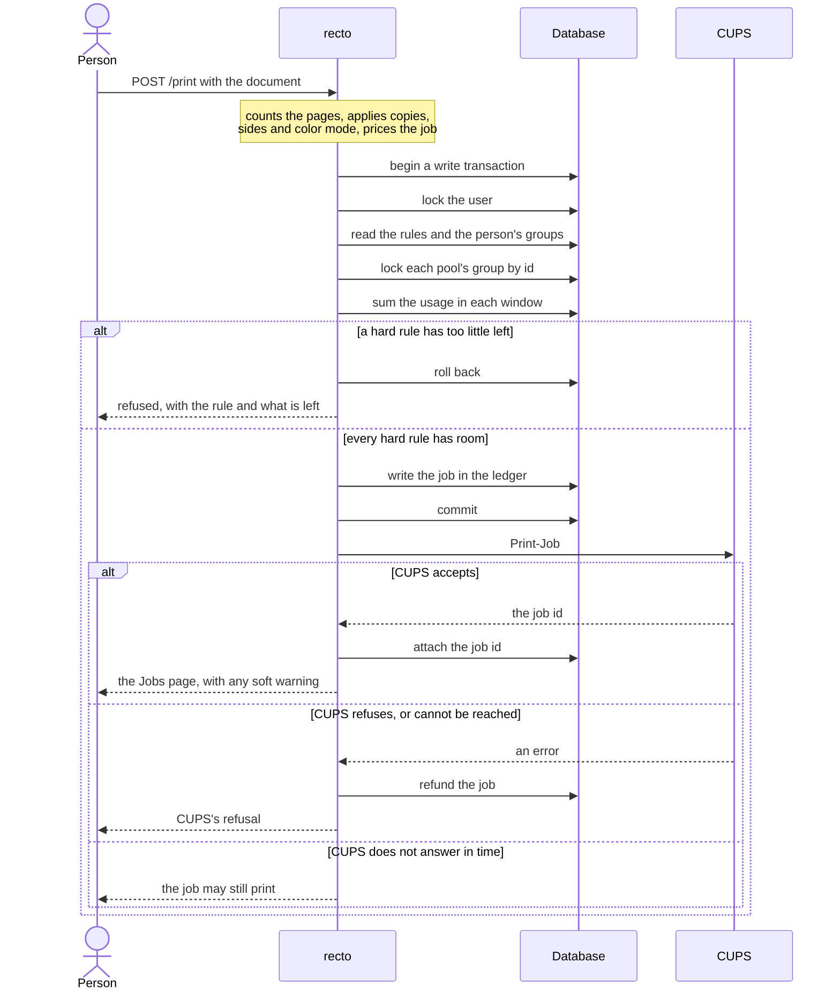

# How quotas work

recto enforces print quotas itself, when someone presses **Print**, rather than leaving them to
CUPS. This page explains the three choices that shape them: rules evaluated over a ledger, counts
taken when a job is sent, and a check that two jobs cannot both slip through.

## Rules over a ledger

recto writes every job it sends in a ledger, one row per job, with what it counts for: pages,
sheets, color and black-and-white pages, and cost. Quota rules are separate: each one says what
to count, over which period, for whom and up to how much. To check a job, recto sums the ledger
rows a rule covers in its current window.

The common alternative is a counter per person, decremented by each job and reset each month.
Counters are cheap to read, but they hold a decision that was made once and cannot be revisited:

- **Changing a rule applies at once.** Raise a monthly limit on the 20th, limit a rule to one
  printer, or add a group rule, and the usage people see is recomputed from the jobs already
  printed. A counter would have to be rebuilt, or would keep the old rule's view.
- **Rolling periods are exact.** "200 pages in any 30 days" means each job stops counting 30
  days after it was sent. A counter has no way to let one job age out; the ledger does it by
  date.
- **Nothing has to run at midnight.** A window is computed from the time of the check, in
  `RECTO_TIMEZONE`, so there is no reset task to miss when recto is stopped, and no gap when the
  clocks change.
- **Corrections are rows, not arithmetic.** A refund marks one row, a grant adds an amount with an
  expiry, a reset records a moment. Each keeps who did it and why, and none rewrites the past.
  A reset is a moment rather than an amount for the same reason as rolling periods: subtracting
  "what was used so far" would go wrong as soon as old jobs aged out.
- **The same ledger answers other questions**, such as who printed what and what it cost.

Summing is more work than reading a counter, but a household or a school prints thousands of
jobs a year, not millions, and the sums run on indexed columns.

## Counts at submission

recto counts a job when it is sent: it reads the PDF's pages, applies the page ranges, copies,
sides and color mode, and prices it. The alternative, counting what the printer reports once it
has printed, looks more accurate but is not:

- A quota has to refuse a job **before** it prints. A count that arrives afterwards can only
  record the overrun.
- Many printers report no page count to CUPS, or only a total for the job, late, or not at all
  when they are turned off mid-job.
- People can see, before they print, what a job will cost them, and the job's cost does not move
  when the prices change later.

The cost of this choice is that a job counts what was asked, not what came out. Refunds correct
the clear case: a job that CUPS refused, never received, or canceled before it started printing
gave nothing, and stops counting. A job canceled halfway keeps its counts, because recto cannot
tell reliably how much of it printed. Likewise, color is the color mode the person chose, not
what each page contains: detecting color per page would mean rendering every document, and the
person can always choose black and white.

A PDF recto cannot read has no page count. When a rule needs one, the job is refused rather than
printed for free; when only the number of jobs is limited, it prints.

## Two jobs at once

The hard part of a quota is two jobs arriving together: two browser tabs, or two members of a
pool, each sending a job when one page is left. If both read the usage before either is counted,
both see a page left and both print.

recto makes the check and the counting one step: it reads the usage, decides, and writes the job
in the ledger inside a single database transaction, and only then asks CUPS to print. A second
job that needs the same budget waits until the first is committed, then reads a usage that
includes it.

How the second job waits depends on the database:

- **SQLite** has one writer at a time. recto opens the transaction with `BEGIN IMMEDIATE`, which
  takes the write lock before the first read, so the second check starts only once the first has
  committed. The lock step does nothing there.
- **PostgreSQL** runs at its default isolation, `READ COMMITTED`, where two transactions can read
  the same usage side by side. recto first locks rows with `SELECT ... FOR UPDATE`: the user's
  row, which every job of the same person shares, before it reads the rules, then the row of each
  pool's group, which every job charged to that pool shares. Jobs that share no budget share no row and do not wait for
  each other. The groups are locked in ascending order of id, so two jobs that meet several pools
  always queue on the same first row and cannot each hold a lock the other needs.

The rules are read inside the transaction too. A job prepared while no rule was enabled is still
checked when a rule is enabled before the job is written, rather than slipping through unchecked.

The job is written before CUPS is asked, so a job can never print without being counted. The
opposite mistake, a job counted that never printed, is the one recto can repair: a refusal from
CUPS refunds the row at once, and a row that never received a CUPS job id, because recto stopped
in between or CUPS never confirmed the job, is refunded after ten minutes. A job sent to CUPS
without an answer is not refunded at once, since CUPS may have queued it and may print it.

## Failing closed

When quotas are configured and the database cannot be reached, recto refuses to print. The other
choice would make every limit void whenever the database is slow or down, which anyone could wait
for. A household that sets no rule is barely affected: recto still reads the database to learn
that there are no rules, as it already does to learn who may use each printer, but past that the
ledger is written when it can be, and printing does not depend on it.

## What quotas do not cover

Quotas apply to what goes through recto. Anyone who can send jobs to CUPS directly, from the same
network, is not counted: keep CUPS reachable only by recto, as the example configuration does
(see [Security model](security.md#cups)). Group rules and pools follow the groups recorded
at each person's last sign-in, so a change at the identity provider takes effect at their next
sign-in.
