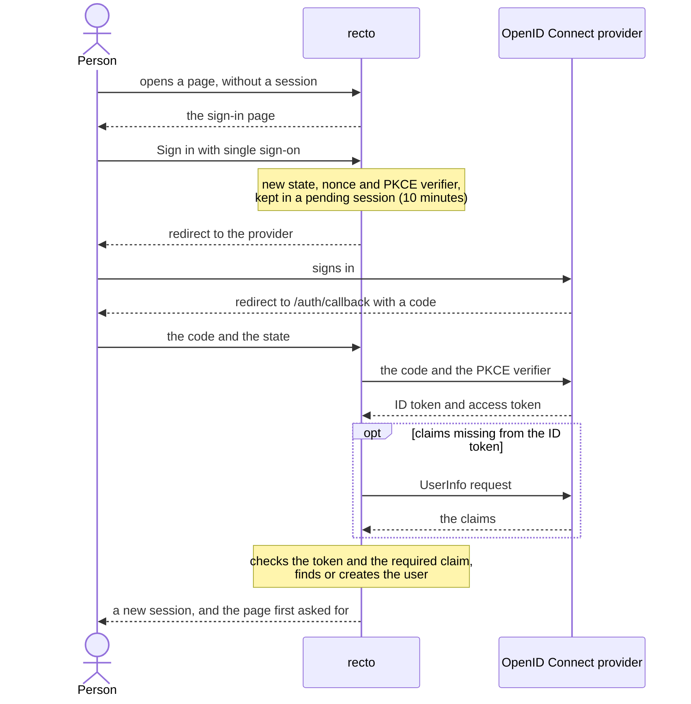

# Sign-in and sessions

## Two ways in

recto signs people in with **local accounts**, a username and a password kept in its own
database, or through an **OpenID Connect provider**, or both at once.

Single sign-on is the better choice when a home server already has an identity provider for its
other apps: one account per person across all of them, two-factor authentication and passkeys
from the provider, and no password in recto. Many households have no such provider, though, and
setting one up only to print is out of proportion. Local accounts let recto stand alone: one
command creates the first administrator, who creates the other accounts from the web page.

Both can run side by side. A family can sign in through the provider, and a babysitter or a guest
with a local account that is easy to disable afterwards.

## Local accounts

There is no self-registration and no "forgot my password" email. recto sends no email at all,
and an open sign-up page would let anyone who reaches recto print. Administrators create the
accounts and set new passwords when one is forgotten.

Passwords are checked for length only, at least 12 characters by default, following current
advice ([NIST SP 800-63B](https://pages.nist.gov/800-63-4/sp800-63b.html)): a long passphrase is
both easier to remember and harder to guess than a short password with forced symbols. The
limit of 1,024 characters only keeps hashing cheap. The [security model](security.md#passwords)
says how they are stored and how guessing is slowed down.

## Single sign-on

recto is a *public client*: it has no client secret, because a secret in a self-hosted app is
one more thing to generate, store and rotate, and adds little when the redirect URIs are fixed.
It uses the authorization code flow with **PKCE**, which protects the code on its way back:

1. Someone opens recto without a session and chooses single sign-on. recto skips its own page
   when nobody could use its password form: local accounts are off, or no account has a
   password yet. recto creates a random `state`, a `nonce` and a PKCE verifier,
   keeps them in a short-lived pending session (10 minutes), and redirects to the provider.
2. The person signs in at the provider, which redirects back to `/auth/callback` with a code.
3. recto checks the `state`, exchanges the code with the verifier, and checks the ID token's
   signature, issuer, audience, expiry and nonce.
4. When the token lacks the profile claims, or a claim recto was told to read (the required, the
   administrator or the groups claim), recto asks the UserInfo endpoint for them.
5. recto checks the required claim, if one is configured, finds the user or creates it, applies
   the administrator and groups claims, then starts a fresh session with a new id, so an id seen
   before sign-in is worthless after it.

The provider's details come from its discovery document, fetched at the first sign-in rather than
at startup: recto starts even when the provider is down, and recovers without a restart when it
comes back. When the provider rotates its signing keys, recto fetches them again on the first
token signed with an unknown key.

## Who the person is

A single sign-on user is found by the provider's issuer and subject, the one identifier a
provider promises never to reuse or change. Usernames and email addresses can change, or pass
to someone else, so recto never matches on them.

The username is chosen at the first sign-in, from `preferred_username`, then `email`, then `sub`,
and kept exactly as the provider sends it. It is what CUPS records as the owner of print jobs, so
it must not change: a person renamed in the provider still owns their jobs in recto. When
another user already has the name, the newcomer gets it with `-2`, `-3` and so on appended.

A local account and a single sign-on user are never merged, even with the same email address.
Merging on email would let whoever controls an address at the provider take over the local
account.

## Administrators

Administrators manage accounts and decide which groups may use each printer and scanner; by
default, everyone signed in can use every device, as before recto had accounts. The first administrator comes from the command line, which only
whoever runs the server can use; later ones from the Users page, or from the provider's
administrator claim.

The claim only takes back what it gave. An administrator appointed by hand stays one when the
provider says otherwise, so a misconfigured claim cannot remove the administrator who would fix
it. Administration given by the claim cannot be changed on the web page, where the change would
be undone at the next sign-in.

## Sessions

A session is a random id in a cookie (`recto_session`: `HttpOnly`, `SameSite=Lax`, and `Secure`
when `RECTO_PUBLIC_URL` is HTTPS), pointing to a row of the database. It lasts 12 hours after the
last request, so a session in daily use does not expire in the middle of a scan.

Sessions live in the database rather than in memory for two reasons. Restarts and upgrades no
longer sign everyone out. And recto reads the user behind the session at every request, so
disabling someone, or setting their password, ends their sessions at their next click rather
than up to 12 hours later.

Signing out ends the session in recto. What happens next depends on how the session signed in,
not on the user, since a single sign-on user may also have a password. After a password sign-in,
the browser lands on the sign-in page: the provider has no session to end. After single sign-on,
recto sends the browser to the provider's end-session endpoint, when there is one, so the
provider's session ends too; otherwise the next sign-in would silently reuse it. Someone the
provider signed in but recto refused, on the **No access** page, goes to the provider too, so
they can sign in with another account.
