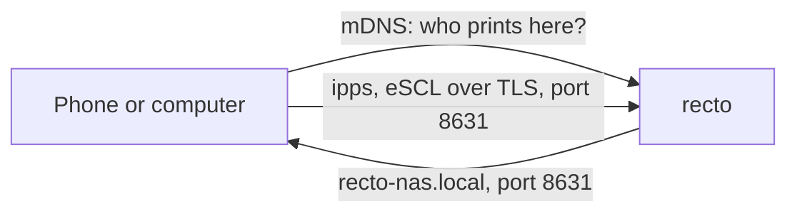

# Let devices find recto

Computers and phones list the printers and scanners that announce themselves on their local
network, with DNS-SD over multicast DNS (Bonjour, AirPrint, Mopria). This guide has recto announce
its printer, and its scanners open to everyone, so that:

- iPhones, iPads and Macs list recto in their Print menu and printer settings, and ask for a
  name and a password the first time;
- Android phones list it through the Mopria Print Service;
- Linux desktops list it, and sane-airscan finds its scanners;
- scan apps that send no password (Image Capture, Windows Scan, Mopria Scan) scan from the
  networks you open to them.

People still need a [device password](../reference/accounts.md#device-passwords) to print.
Announced services point at the **LAN listener**, a second, TLS-only port of recto that serves
the printer and the scanners and nothing else (see [Security model](../explanation/security.md#the-lan-listener)).



## Before you start

- recto runs on a Linux host on the same network, the same subnet, as the devices. Multicast DNS
  does not cross routers, so a guest network or another VLAN sees nothing.
- Docker Engine on Linux. Docker Desktop on macOS and Windows has no host networking on the LAN:
  there, devices can still add recto by its address (see the guides for each system), but not
  find it.
- The host's firewall lets in TCP on the LAN listener's port (`8631` below) and UDP on port 5353
  from the LAN.

## Announce recto with host networking

Multicast does not cross Docker's bridge network, so recto joins the host's network. The example
override does that, and moves CUPS to the host's loopback, which recto then reaches at
`127.0.0.1:631`:

```sh
docker compose -f compose.yml -f examples/compose-dnssd.yml up -d --wait
```

It sets:

```yaml
RECTO_LAN_LISTEN_ADDRESS: "[::]:8631"
RECTO_DNSSD: "true"
RECTO_CUPS_URL: http://127.0.0.1:631
```

`[::]:8631` takes IPv6 and IPv4 connections on every address of the host. Bind to `0.0.0.0:8631`
for IPv4 only; recto then announces no IPv6 address, so clients that try IPv6 first do not meet
a closed port. With host networking, the web page is on port 8080 of the host directly, and
nothing is published.

At startup recto logs the LAN listener with its certificate's fingerprint, then what it announced:

```text
LAN listener address=[::]:8631 fingerprint=3A:7F:...
DNS-SD responder host=recto-nas.local. interfaces=eth0
announced over DNS-SD services=recto._ipps._tcp.local., Canon LiDE 300 (recto)._uscans._tcp.local.
```

recto announces itself as `recto-<hostname>.local`, never as the host's own name, which the host's
avahi-daemon keeps. Both share port 5353 without trouble.

### Check from the host

With Avahi's tools on the host (`avahi-utils` on Debian):

```sh
avahi-browse -rt _ipps._tcp
avahi-browse -rt _uscans._tcp
avahi-resolve -n recto-nas.local
```

Each lists recto with the host's addresses and port 8631. Then add the printer on a phone or a
Mac, as its guide says.

### Choose the interfaces

By default recto announces on every interface except loopback, Docker's (`docker*`, `br-*`,
`veth*`), virtual machines' (`virbr*`, `vnet*`, `lxcbr*`, `lxdbr*`, `podman*`, `cni*` and
Kubernetes') and VPNs' (point-to-point interfaces, `tun*`, `tap*`, `wg*`, `wt*`, `tailscale*`,
`zt*`, `nebula*`, `ham*`). To choose:

```yaml
RECTO_DNSSD_INTERFACES: eth0,wlan0
```

A name that does not exist, or has no address, stops recto at startup with a message naming the
setting.

### Rename the printer

The printer is announced under the brand name, and each scanner as `<vendor> <model> (<name>)`.
To show another name in Print dialogs:

```yaml
RECTO_DNSSD_NAME: Office printer
```

## Let discovered apps scan

Image Capture on a Mac, Windows Scan and Mopria Scan send no password to a scanner they
discovered. recto announces only the scanners open to everyone, and lets such apps scan on them
from the networks you list:

```yaml
RECTO_ESCL_OPEN_NETWORKS: 192.168.1.0/24
```

Anyone on those networks can then scan on those scanners, as with a network scanner's own scan
function, and their scans are logged without a user (see
[Scanning without a password](../reference/scanning.md#scanning-without-a-password)). Scanners
limited to some groups are never announced: people reach them with their personal scan address,
shown on the Account page.

## Trust the certificate

The LAN listener has a self-signed certificate, made at its first start for
`recto-<hostname>.local` and kept in the data volume, under `lan-tls`. Devices accept it the first
time and remember it, as with any AirPrint printer. Compare the fingerprint a Mac shows with the
one in the log if you want to be sure.

To use your own certificate instead, for example one your devices already trust, set both:

```yaml
RECTO_LAN_TLS_CERTIFICATE: /certs/lan.pem
RECTO_LAN_TLS_KEY: /certs/lan.key
```

It must name `recto-<hostname>.local`, the name devices connect to. Changing the certificate, or
deleting `lan-tls`, makes devices that remembered the old one refuse recto until they forget it
and add it again.

## Keep the bridge network

If recto must stay on Docker's bridge network, the host's own avahi-daemon can announce it
instead:

1. Publish the LAN listener on the host, with `ports: ["8631:8631"]` on the recto service, and
   `RECTO_LAN_LISTEN_ADDRESS: 0.0.0.0:8631`. Leave `RECTO_DNSSD` off.
2. Write the service files and copy them to Avahi's folder:

   ```sh
   docker compose exec recto /app/recto dnssd-services --port 8631 /data/avahi
   docker compose cp recto:/data/avahi/. /etc/avahi/services/
   ```

   avahi-daemon reads the folder again by itself.
3. Run step 2 again after adding a scanner, or changing who may use one.

The files point at the host's own name, `<hostname>.local`. On a bridge network the container's
host name is its id, which the generated certificate then names: devices accept it the first
time all the same. To have it name `<hostname>.local`, set `hostname:` on the recto service to
the host's name before the first start with the LAN listener. Avahi announces the files on the
interfaces of its own configuration (`allow-interfaces` in `/etc/avahi/avahi-daemon.conf`); by
default that includes `docker0`.

An mDNS reflector does not work: it repeats the records as recto sees them, with the bridge's
`172.x` addresses, which the LAN cannot reach. A macvlan network gives the container an address
of its own on the LAN, where `RECTO_DNSSD` could announce it, but the host itself then cannot
reach the container without more setup; this guide does not cover it.

## Troubleshoot

- **Nothing is listed.** Check the log for `announced over DNS-SD`, then `avahi-browse` on the
  host. A device on Wi-Fi may be on another network than recto's wired one: some routers keep
  them apart, or block multicast between them.
- **The printer is listed with a 172.x address.** recto is not on the host's network: check
  `network_mode: host`.
- **The device says it cannot connect.** Check the firewall for TCP 8631, and that the address
  of `RECTO_LAN_LISTEN_ADDRESS` is one the device reaches.
- **The Mac or iPhone refuses the certificate.** The certificate changed since it first connected:
  remove the printer, then add it again.
