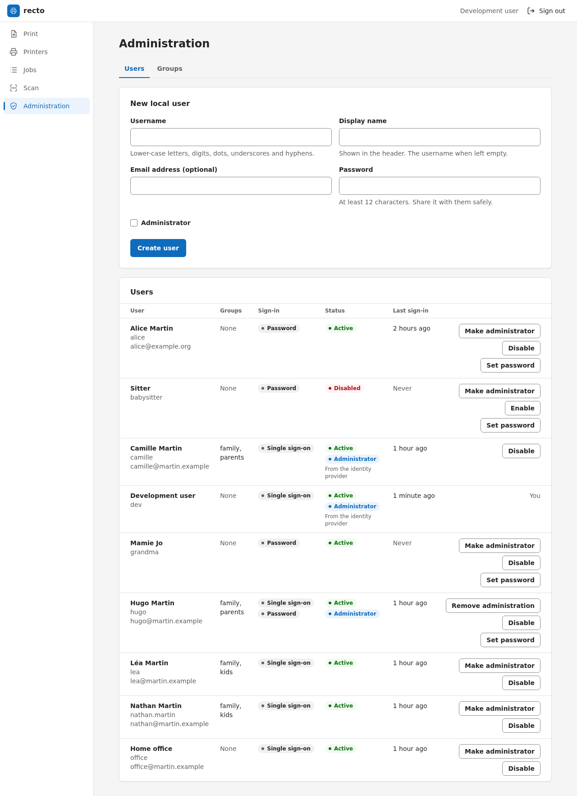

# Manage users and administrators

Administrators manage accounts on the **Administration** page, under **Users**. The rules for
usernames, passwords and administrators are in the [accounts reference](../reference/accounts.md).

<picture>
  <source media="(prefers-color-scheme: dark)" srcset="../images/users-dark.png">
  
</picture>

## Create the first administrator

The first administrator is created on the server, with the command line:

```sh
docker compose exec recto /app/recto create-administrator --username admin
```

recto asks for the password twice. In a script, pipe it in instead, on one line:

```sh
printf '%s\n' "$PASSWORD" | docker compose exec -T recto /app/recto create-administrator --username admin
```

`--display-name` and `--email` set the rest of the account (see
[Command line](../reference/command-line.md#recto-create-administrator)).

With single sign-on, an administrator can come from the identity provider instead (see
[Set up single sign-on](sign-in.md#make-administrators-from-the-provider)), or be appointed after
their first sign-in with `recto administrator <USERNAME>`.

## Create a local account

There is no self-registration. Under **New local user**, set:

- **Username**: what the person signs in with. Lower-case letters, digits, `.`, `_` and `-`; it
  cannot be changed later.
- **Display name**: shown in the header. The username when left empty.
- **Email address**, optional: the person can sign in with it instead of the username.
- **Password**: at least 12 characters, or `RECTO_PASSWORD_MINIMUM_LENGTH`. Give it to the person
  in a safe way; they can change it on their **Account** page.
- **Administrator**, to let them manage accounts too.

Press **Create user**.

## Reset a password

There is no reset by email. Press **Set password** on the person's row, type the new password and
press **Set**. All of the person's sessions end: they sign in again with the new password.

Only users who already have a password get the button. Single sign-on users change their
password at their identity provider.

## Disable a user

Press **Disable** on the person's row. They cannot sign in any more, and their sessions end at
their next request. Their account and its groups are kept: **Enable** lets them sign in again.

To keep someone from signing in through single sign-on, disable them here or remove their access
in the provider (see [Let only some people in](restrict-access.md)).

## Grant or remove administration

Press **Make administrator** or **Remove administration** on the person's row.

Administration marked **From the identity provider** comes from the administrator claim, and has
no button: change it in the provider. The next sign-in applies the change.

## See usage and adjust quotas

With [print quotas](set-quotas.md) set, a **Quotas** column shows, on each person's row, their
usage of each enabled rule for everyone, their groups or them that applies to them, in its current
window, such as "Monthly pages: 30 of 100 pages used this month", with ", plus 20 pages granted"
when they have extra. Under each rule, **Grant extra or reset** opens two forms:

- **Grant extra** gives the person more of that rule until its window ends. Type the **Extra
  allowance** and a **Reason**.
- **Reset** makes what the person printed so far stop counting toward that rule. Type a
  **Reason**.

The reason is required, up to 200 characters, and is kept with your name. Both are described in
[Set print quotas](set-quotas.md#give-extra). A pool, shared by a group, is adjusted from its rule
on the **Quotas** page instead.

## Change your own password

When you sign in with a password, your name at the top of every page leads to your **Account**
page, where you change it. It asks for the current one. Your other sessions end; the one you are
using stays signed in.

Nobody can disable their own account, change their own administration or set their own password
on the Users page, so the last administrator cannot lock everyone out by mistake.

## See the groups

The **Groups** tab lists each group the identity provider sent, with its members. Groups are
read-only in recto: they come from `RECTO_OIDC_GROUPS_CLAIM` at each sign-in (see
[Set up single sign-on](sign-in.md#show-the-groups-from-the-provider)). To limit a printer or a
scanner to groups, see [Let only some people in](restrict-access.md#limit-printers-and-scanners-to-groups).

## Regain access without an administrator

When nobody who can sign in is an administrator any more, use the command line on the server:

```sh
# Make an existing user an administrator.
docker compose exec recto /app/recto administrator alex
# Or create a new one.
docker compose exec recto /app/recto create-administrator --username rescue
```

`recto administrator <USERNAME> --remove` takes administration away, including administration
that came from the identity provider; if the provider's claim still grants it, the person's next
sign-in gives it back. The command line refuses nothing: whoever can run it can read the database
anyway.
