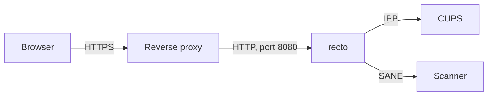

# Run behind a reverse proxy

recto serves plain HTTP on port 8080. Put a reverse proxy with TLS in front of it, and set
`RECTO_PUBLIC_URL` to the address people open through the proxy, such as
`https://recto.example.org`. Sign-in redirects and the `Secure` flag of the session cookie depend
on it. HTTPS is also required to [install recto as an app](install-app.md).



recto must be at the root of its address: `https://recto.example.org` works,
`https://example.org/recto` does not, and recto refuses to start with such a URL.

## What every proxy must do

- Terminate TLS, and redirect HTTP to HTTPS.
- Keep the `Host` header the browser sent, and do not rewrite `Origin`. recto checks sign-in posts
  against them and refuses the request when they do not match `RECTO_PUBLIC_URL`.
- Wait at least 600 seconds for a response, so long scans finish (see
  [Let long scans finish](#let-long-scans-finish)).
- Accept request bodies a little above `RECTO_MAX_UPLOAD_SIZE`, 50 MiB by default (see
  [Let uploads through](#let-uploads-through)).
- Cache nothing. Pages are per user, and `/sw.js` and `/manifest.webmanifest` are sent with
  `Cache-Control: no-cache` so that browsers see a new version at once. This includes a CDN in
  front of the proxy.
- Replace `X-Forwarded-For` with the client's address, when you set
  `RECTO_TRUST_FORWARDED_HEADERS` (see
  [Count sign-in attempts per person](#count-sign-in-attempts-per-person)).
- Optionally, check `GET /health` for a `200` answer.

recto uses no WebSockets in production, so no upgrade rules are needed.

The example files are in [`examples/proxy`](https://github.com/AlixANNERAUD/recto/tree/main/examples/proxy).
Replace `recto.example.org` in them with your host name.

## Let long scans finish

A scan answers only once the whole batch is read, which can take minutes for a stack in the
feeder. Many proxies give up on a response after 60 seconds. Raise that limit for recto:

- **nginx:** `proxy_read_timeout 600s;` (the default is 60 seconds).
- **Apache:** `ProxyTimeout 600` (the default is the `Timeout` directive, 60 seconds).
- **HAProxy:** `timeout server 600s` (and `timeout client 600s`).
- **Caddy:** no limit by default.
- **Traefik:** no limit by default, unless `forwardingTimeouts.responseHeaderTimeout` is set on
  the transport.
- **Cloudflare Tunnel:** cuts requests after 100 seconds, and no setting raises it on the free
  plans. Scan long batches in smaller stacks.

When the proxy gives up, the Scan page says **The connection to recto was cut before the scan
finished.** The scanner may still finish, but the result is lost.

## Let uploads through

Files up to `RECTO_MAX_UPLOAD_SIZE` (50 MiB by default) are sent to recto in one request, along
with the form's other fields. recto accepts a body up to that size plus 64 KiB, so set the
proxy's limit a little above it, 51 MiB for the default (the examples do):

- **nginx:** refuses bodies over 1 MiB by default: `client_max_body_size 51m;`.
- **Apache:** limits bodies to 1 GiB by default since 2.4.54 (none before): `LimitRequestBody
  53477376`.
- **Caddy:** no limit by default; the example sets `max_size 51MiB`.
- **HAProxy:** no limit by default.
- **Traefik:** no limit by default, but its entry points stop reading a request after 60
  seconds, which can cut a large upload on a slow connection: the example raises
  `respondingTimeouts.readTimeout` to 600 seconds.
- **Cloudflare:** accepts 100 MB on its free and Pro plans.

## Printing from computers and phones

Computers and phones [print through recto](../reference/printing.md#printing-from-computers-and-phones)
at `https://recto.example.org/ipp/print` and at personal addresses under `/device/`, over the
same proxy, with the same certificate and body limit as the web page: nothing to open, and
documents up to `RECTO_MAX_UPLOAD_SIZE` already get through.

**Keep `/device/` out of the access log.** A personal address holds a device password. recto
never logs it, but most proxies log every path. The examples turn it off for `/device/`:

- **nginx:** a `location /device/` with `access_log off;` and the same proxy settings. nginx's
  error log quotes the request too, for instance when recto is restarting and the proxy cannot
  reach it, so the block also sets `error_log <your error log> crit;`: only critical errors, such
  as a full disk, are still written for `/device/`, and they may still name the path.
- **Caddy:** `log_skip /device/*` (Caddy 2.8 or later).
- **Apache:** `SetEnvIf Request_URI "^/device/" dontlog` and `env=!dontlog` on `CustomLog`.
- **HAProxy:** `http-request set-log-level silent if { path_beg /device/ }`.
- **Traefik:** writes no access log unless `--accesslog` is set, and cannot leave out one path
  when it is; keep that log private.
- **Cloudflare Tunnel:** request logs are kept by Cloudflare (Logpush on Enterprise plans); the
  path is in them.

**Exempt `/ipp/`, `/device/` and `/eSCL/` from forward authentication.** An authenticating
proxy, such as Authelia, Authentik or Cloudflare Access, in front of recto answers devices with
a sign-in page they cannot follow, and printing fails. recto authenticates these paths itself,
with device passwords:

- **Authelia**, an access control rule before the others:

  ```yaml
  access_control:
    rules:
      - domain: recto.example.org
        resources:
          - '^/(ipp|device|eSCL)/'
        policy: bypass
  ```

- **Authentik**, in the proxy provider of recto, under **Unauthenticated Paths**:

  ```text
  ^/(ipp|device|eSCL)/
  ```

- **Cloudflare Access**, a second self-hosted application for `recto.example.org/ipp`,
  `recto.example.org/device` and `recto.example.org/eSCL`, with one policy whose action is
  **Bypass** for **Everyone**. Cloudflare applies the most specific path first.
- **Traefik with a `forwardAuth` middleware**, a second router for the same service without it:

  ```yaml
  traefik.http.routers.recto-devices.rule: Host(`recto.example.org`) && (PathPrefix(`/ipp/`) || PathPrefix(`/device/`) || PathPrefix(`/eSCL/`))
  traefik.http.routers.recto-devices.entrypoints: websecure
  traefik.http.routers.recto-devices.tls.certresolver: letsencrypt
  traefik.http.routers.recto-devices.service: recto
  ```

- **nginx with `auth_request`**, `auth_request off;` in the `location /device/` of the example
  and in a `location /ipp/` and a `location /eSCL/` like it.

## Count sign-in attempts per person

recto limits password sign-in attempts per client address (see
[Password sign-in limit](../reference/accounts.md#password-sign-in-limit)). Behind a proxy, every
request comes from the proxy's address, so all your users share one budget: a few wrong
passwords from one person make everyone wait.

To count them per client, have the proxy send the client's address in `X-Forwarded-For`, and tell
recto to read it:

```yaml
RECTO_TRUST_FORWARDED_HEADERS: "true"
```

The proxy must **replace** any `X-Forwarded-For` the client sent, not add to it. Otherwise a
client can send its own header with a new address at each attempt, and never be limited.

- **nginx:** `proxy_set_header X-Forwarded-For $remote_addr;`, as in the example. Not
  `$proxy_add_x_forwarded_for`, which keeps what the client sent.
- **Apache:** `RequestHeader unset X-Forwarded-For`. mod_proxy then adds the client's address.
- **HAProxy:** `http-request set-header X-Forwarded-For %[src]`.
- **Caddy:** replaces it by default.
- **Traefik:** replaces it by default, unless `forwardedHeaders.trustedIPs` or `insecure` is set
  on the entry point.
- **Cloudflare Tunnel:** appends the client's address to any `X-Forwarded-For` the client sent,
  so a client can still pick the address recto reads. Leave `RECTO_TRUST_FORWARDED_HEADERS`
  off behind it.

Leave the setting off when recto is reachable without the proxy, such as on its published port:
anyone could then send the header.

## nginx

File: `examples/proxy/nginx/recto.conf`. Put it in `/etc/nginx/conf.d/`, get a certificate with
`certbot certonly --nginx -d recto.example.org`, then run `nginx -t` and reload.

```nginx
client_max_body_size 51m;
proxy_request_buffering off;

location / {
    proxy_pass http://127.0.0.1:8080;
    proxy_set_header Host $host;
    proxy_set_header X-Forwarded-Proto $scheme;
    proxy_set_header X-Forwarded-For $remote_addr;
    proxy_read_timeout 600s;
    proxy_buffering off;
}
```

The file also redirects port 80 to HTTPS. `proxy_buffering off` and `proxy_request_buffering off`
stream bodies instead of writing them to temporary files. The `location /device/` block keeps
personal printer addresses out of the access log and, but for critical errors, the error log (see
[Printing from computers and phones](#printing-from-computers-and-phones)). To reach recto on the host, publish its
port to the loopback address only (`127.0.0.1:8080:8080` under `ports`).

## Caddy

File: `examples/proxy/caddy/Caddyfile`. Caddy gets and renews the certificate and redirects HTTP
by itself.

```text
recto.example.org {
	request_body {
		max_size 51MiB
	}
	reverse_proxy recto:8080 {
		flush_interval -1
	}
}
```

Use `recto:8080` when Caddy runs in the same Compose project, `127.0.0.1:8080` otherwise.

## Traefik

File: `examples/proxy/traefik/compose.traefik.yml`, a Compose override that adds Traefik with
Let's Encrypt and labels `recto`:

```sh
docker compose -f compose.yml -f examples/proxy/traefik/compose.traefik.yml up -d --wait
```

Add `RECTO_HOST=recto.example.org` and `ACME_EMAIL=you@example.org` to `.env`, next to
`RECTO_PUBLIC_URL`. The essential labels are:

```yaml
traefik.http.routers.recto.rule: Host(`recto.example.org`)
traefik.http.routers.recto.entrypoints: websecure
traefik.http.routers.recto.tls.certresolver: letsencrypt
traefik.http.services.recto.loadbalancer.server.port: "8080"
```

The override removes recto's published port (`ports: !reset []`, which needs Docker Compose 2.24
or later), so recto is reachable only through Traefik, and it sets
`RECTO_TRUST_FORWARDED_HEADERS`. It also gives the `websecure` entry point 600 seconds to read a
request (`--entrypoints.websecure.transport.respondingTimeouts.readTimeout=600s`), so a large
upload on a slow connection is not cut after the default 60.

## Apache

File: `examples/proxy/apache/recto.conf`. Enable the modules with
`a2enmod proxy proxy_http ssl headers rewrite`, then check with `apachectl -t`.

```apache
LimitRequestBody 53477376
ProxyPreserveHost On
RequestHeader unset X-Forwarded-For
RequestHeader set X-Forwarded-Proto "https"
ProxyTimeout 600
ProxyPass        / http://127.0.0.1:8080/ timeout=600
ProxyPassReverse / http://127.0.0.1:8080/
```

## HAProxy

File: `examples/proxy/haproxy/haproxy.cfg`. HAProxy wants the certificate chain and the private
key in one PEM file (see the comment in the file).

```text
defaults
    mode http
    timeout connect 5s
    timeout client  600s
    timeout server  600s

frontend https
    bind :443 ssl crt /etc/haproxy/certs/recto.example.org.pem alpn h2,http/1.1
    http-request set-header X-Forwarded-For %[src]
    http-request set-header X-Forwarded-Proto https
    default_backend recto

backend recto
    server recto 127.0.0.1:8080 check
    option httpchk
    http-check send meth GET uri /health
```

## Cloudflare Tunnel

File: `examples/proxy/cloudflared/config.yml`. Cloudflare terminates TLS, so recto needs no
certificate and no open port.

```yaml
ingress:
  - hostname: recto.example.org
    service: http://localhost:8080
  - service: http_status:404
```

Cloudflare cuts a request that has had no response after 100 seconds, and no setting on the free
and Pro plans raises it: scan long batches in smaller stacks. Do not enable caching rules for
`recto.example.org`.

## Check

1. Check the headers. Both `sw.js` and the page must say `no-cache` or `private`, and neither may
   be cached by the proxy:

   ```sh
   curl -sI https://recto.example.org/sw.js | grep -i cache-control
   curl -sI https://recto.example.org/health
   ```

   The first prints `cache-control: no-cache`, the second `HTTP/2 200`. Plain HTTP must answer
   with a redirect to HTTPS: `curl -sI http://recto.example.org/`.
2. Open `RECTO_PUBLIC_URL` and check that your browser shows a valid certificate, then sign in.
   If sign-in loops or fails, see [Troubleshoot](troubleshoot.md#sign-in).
3. Print a file close to `RECTO_MAX_UPLOAD_SIZE`. A `413` means the proxy's body limit is too low.
4. Check that devices reach the printer without a sign-in page in the way:

   ```sh
   curl -s -o /dev/null -w '%{http_code}\n' -X POST https://recto.example.org/ipp/print
   ```

   It prints `400` (an empty IPP request), not `302` or `401`, and the proxy's access log has no
   line for `/device/`.
5. Scan a long batch, or one that takes more than a minute. **The connection to recto was cut
   before the scan finished** means the proxy's timeout is too short.
6. If you set `RECTO_TRUST_FORWARDED_HEADERS`, enter a wrong password from two devices. Each
   should be counted on its own (see [Password sign-in limit](../reference/accounts.md#password-sign-in-limit)).
7. [Install recto as an app](install-app.md) on a phone or computer.
