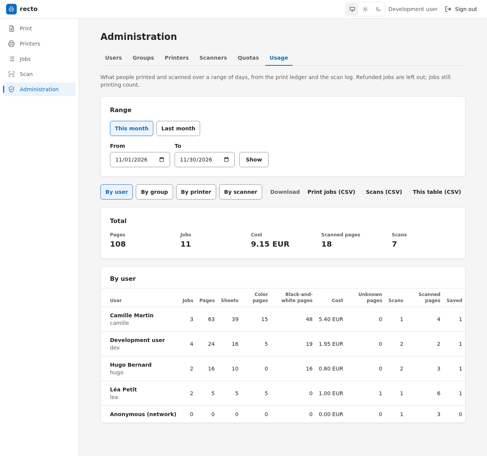

# See who printed and scanned what

The **Usage** tab of the **Administration** page totals what was printed and scanned over a range
of days, for everyone and by user, group, printer or scanner. It reads the print ledger and the
scan log, which recto keeps on its own: there is nothing to turn on. What each column counts is
in the [reports reference](../reference/reports.md).

<picture>
  <source media="(prefers-color-scheme: dark)" srcset="../images/usage-dark.png">
  
</picture>

## Before you start

Set `RECTO_TIMEZONE` to your time zone, such as `Europe/Paris` (see
[Configuration](../reference/configuration.md)). Days start at midnight there, so a job printed
at 23:30 on the last evening of the month counts in that month. With the default, `UTC`, a day
may end in the middle of your evening.

## Pick a range

1. Open **Administration**, then **Usage**. The page shows this month.
2. Press **Last month** for the month before, or fill in **From** and **To** and press **Show**.
   Both days are included.

The address keeps the range, so you can bookmark it or send it to another administrator.

## Switch tables

Under the range, **By user**, **By group**, **By printer** and **By scanner** pick the table
below the totals. The range stays the same.

- **By user** has a row for everyone who printed or scanned in the range, heaviest first, and a
  row **Anonymous (network)** for scans that came from the network without an account.
- **By group** counts each group's current members. Someone in two groups counts in both, and
  someone in no group in none, so the group rows need not add up to the total.
- **By printer** counts only printing, and **By scanner** only scanning.

## When the numbers look wrong

- **A job is missing.** Jobs that printed nothing (refused by CUPS, or cancelled before
  printing) are refunded and left out. The ledger export still lists them.
- **Pages are 0 but there are jobs.** recto could not count the pages of some documents; they
  are in the **Unknown pages** column.
- **The page says the dates are wrong.** Both dates must be between 2000 and 2999, and **To**
  cannot be before **From**.
