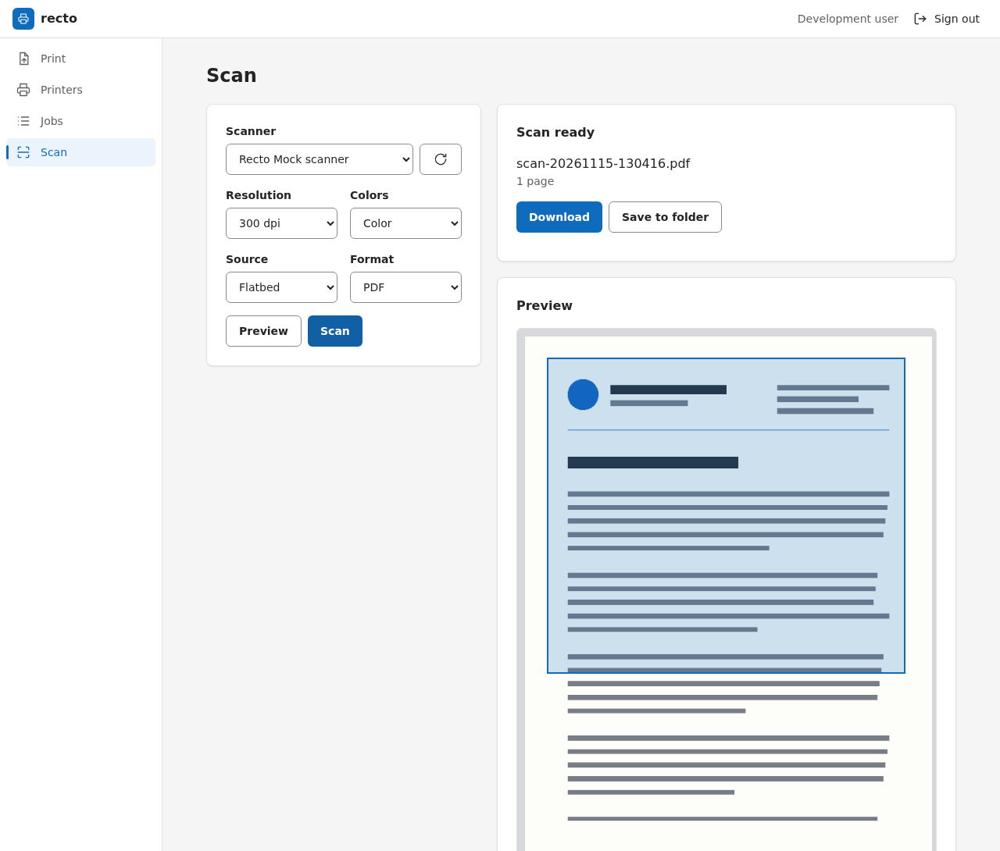

# Introduction

recto is a small self-hosted web app to **print and scan from any browser** through your home
server. Open it on a phone or a laptop, pick a file and a printer, and it prints. Put a page on
the scanner, preview it, and get a PDF to download or to drop straight into
[Paperless-ngx](https://docs.paperless-ngx.com).

<picture>
  <source media="(prefers-color-scheme: dark)" srcset="images/scan-dark.png">
  
</picture>

recto does not drive printers and scanners itself. [CUPS](https://openprinting.github.io/cups/)
does the printing, over IPP, and [SANE](http://www.sane-project.org) does the scanning, through
libsane. recto is the web layer on top: one page for everyone in the house, behind a sign-in,
with no drivers to install on each device.

## What it does

- **Prints** PDF, JPEG and PNG files on any CUPS printer, with copies, two-sided printing, color
  and a page range. It shows each printer's state, supply levels and errors, and the print
  queue, where any job can be cancelled (or only your own, if the operator keeps jobs private).
  Printing works without JavaScript.
- **Scans** from any SANE scanner: network scanners that speak eSCL or WSD (most recent Brother,
  Canon, Epson and HP models), scanners shared by `saned`, and USB scanners. Choose the
  resolution, colors, source and format (PDF, PNG or JPEG), preview the glass and drag to scan
  only part of it.
- **Saves** scans to a folder, such as the consume folder of Paperless-ngx, without ever
  overwriting a file.
- **Signs people in** with local accounts, a username and a password, or with your own OpenID
  Connect provider (Zitadel, Keycloak, Authentik and others), optionally only those with a given
  role or group. Administrators create the local accounts, reset passwords and disable users from
  the **Administration** page.
- **Brands** itself: the operator sets the name, accent color, logo and icon.
- **Follows your theme**: light, dark or the device's setting, with a switch in every page.
- **Installs as an app** on phones and computers, with an offline page.

It runs as one container next to a CUPS server, configured with environment variables only. Its
users and sessions live in a SQLite file on a volume, or in PostgreSQL.

## What it does not do

- **It does not convert documents.** Office files must be exported to PDF first. Converting them
  takes a large, exposed toolchain, which recto keeps out of its container.
- **It does not replace CUPS administration.** Printers are added to CUPS with `lpadmin` (see
  [Add a printer](how-to/add-printer.md)); recto lists what CUPS has.
- **It does not keep scans.** A scan stays available for an hour, for its owner only, then it is
  deleted. Save it to a folder to keep it.
- **It does not separate users much.** By default anyone signed in can use every printer and
  scanner, and see and cancel every print job. Administrators can limit a device to some groups,
  and jobs can be kept private, but these limits apply in recto only. recto is built for a
  household, or a small team, that trusts itself.

## How this documentation is organized

It has four parts, one per need:

- **[Tutorials](tutorials/first-print-and-scan.md)** are lessons. [Your first print and
  scan](tutorials/first-print-and-scan.md) runs recto on your machine with a virtual printer and
  a virtual scanner, so you need no hardware and no identity provider to follow it.
- **[How-to guides](how-to/install.md)** are recipes for a goal you already have: install recto,
  manage users, connect your identity provider, add a network scanner, save into Paperless-ngx,
  back up, fix a printer that answers `400`.
- **[Reference](reference/configuration.md)** describes the machinery: every setting, command,
  account rule, print and scan option, endpoint and log field. Look things up there.
- **[Explanation](explanation/architecture.md)** is background: how recto talks to CUPS and SANE,
  how sign-in and sessions work, what happens to a scan, and what protects what.

recto is free software under the
[Apache-2.0 license](https://github.com/AlixANNERAUD/recto/blob/main/LICENSE); the source, issues
and releases are on [GitHub](https://github.com/AlixANNERAUD/recto).
