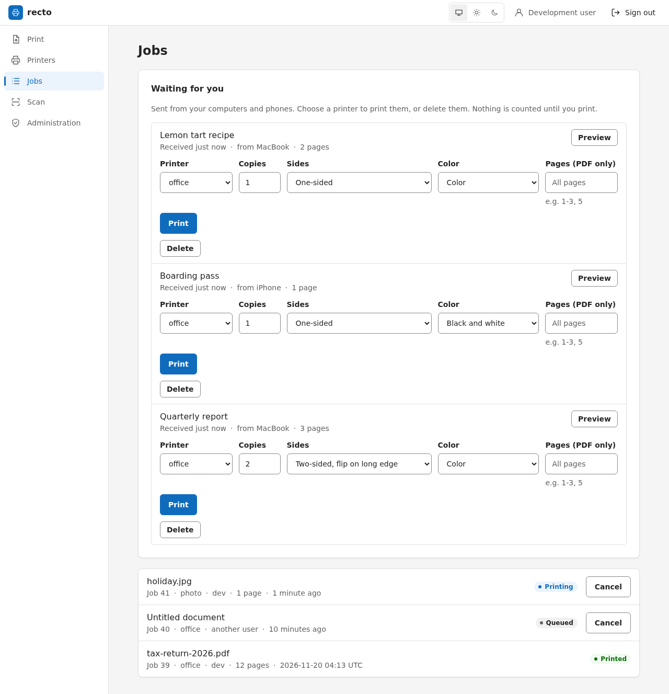

# Printing

## Files

| Format | Recognized by |
| --- | --- |
| PDF | content starting with `%PDF-` |
| JPEG | content starting with the JPEG signature |
| PNG | content starting with the PNG signature |

The file name and the type the browser claims are not trusted: recto reads the start of the file.
Any other file is refused with **Only PDF, JPEG and PNG files can be printed.** The largest file
is `RECTO_MAX_UPLOAD_SIZE`, 50 MiB by default.

## Printing from computers and phones

With OS integration on (`RECTO_OS_INTEGRATION`, the default), recto is also a printer that
computers and phones add like any network printer, with a
[device password](accounts.md#device-passwords). Its addresses carry their port, since `ipps`
alone means port 631:

| Address | For |
| --- | --- |
| `ipps://<host>:<port>/ipp/print` | Devices that ask for a password: macOS, Linux. Any username, the device password as the password. |
| `ipps://<host>:<port>/device/<device password>/ipp/print` | Devices that cannot ask, such as Windows: the personal address, which holds the password. |

`<host>` and `<port>` are those of `RECTO_PUBLIC_URL`, 443 for `https://`; with an `http://`
public URL the addresses are `ipp://`. The Account page shows both when it creates a device
password.

With `RECTO_DNSSD`, recto also announces the printer on the local network as an `_ipps._tcp`
service with the `_universal` subtype, named `RECTO_DNSSD_NAME`, pointing at the LAN listener:
`ipps://recto-<hostname>.local:<port>/ipp/print`, with the same password prompt (see
[Let devices find recto](../how-to/discovery.md)).

What the device sees: one driverless IPP printer (IPP/2.0, IPP Everywhere and AirPrint), named
after the brand, whatever printers CUPS has. It takes the formats below, recognized by their
content as on the Print page, up to `RECTO_MAX_UPLOAD_SIZE`. It offers A4, Letter, Legal, A3 and
A5 paper (the default from `RECTO_DEFAULT_MEDIA`), color and black and white, one- and two-sided,
and 1 to 99 copies. What the device asked for is kept with the job.

| Format | Recognized by | Kept as |
| --- | --- | --- |
| PDF, JPEG, PNG | as on the Print page | itself |
| PWG raster (`image/pwg-raster`), what IPP Everywhere devices such as Windows send | content starting with `RaS2` | PDF |
| Apple raster (`image/urf`), what AirPrint devices such as iPhones send | content starting with `UNIRAST` | PDF |

A raster is a picture of each page. recto turns it into a PDF with one image per page when it
arrives, so the preview, the page count, page ranges and CUPS only ever see a PDF; the Jobs page
still says what the device sent. The printer asks for 8-bit grey or color (`sgray_8`, `srgb_8`,
`W8`, `SRGB24`) at 300 dpi, with back sides upright; recto reads 75 to 600 dpi. Converting is
bounded, and a raster past a bound is refused before recto keeps anything:

| Bound | Value |
| --- | --- |
| Decoded pixels of one page | 160 MiB, a Legal page at 600 dpi in color |
| Decoded pixels of a document | 4 GiB |
| Pages | 500 |
| The PDF made | `RECTO_MAX_UPLOAD_SIZE` |
| Time | 60 seconds, after waiting at most 60 seconds for a place |
| Conversions at once | 2 |

A document sent this way is **held**, not printed: recto keeps it under `RECTO_DATA_DIR/held` and
tells the device the job is complete, with the message **Held in recto until you release it**
(the brand's name for recto), so the device's queue moves on, unless its owner prints directly
(below). Nothing is counted while a job is held: the ledger and quotas only know printed jobs. A held job is deleted after
`RECTO_HELD_JOB_HOURS`, 24 hours by default, unless its owner prints or deletes it first (see
[Held jobs](#held-jobs)).

### Printing directly

On the Account page, **Documents from your devices** chooses what happens to them: **Hold it
until I print it** (the default), or **Print it at once on** one of the printers you may use. A
document printed at once goes through the same path as **Print** on the Jobs page: the printer
access rules, page count, quotas and ledger, with the options the device asked for. An option
the printer does not have is left to its default rather than refusing the document: one-sided
for a printer without two-sided printing, its own color mode, and at most its copies.

The device then hears how it went: **Released in recto** when the document went to the printer,
or a job **completed with errors** and **Not printed:** with the reason when it was refused (a
quota, a printer you may no longer use, a printer that is off). A refused document is held, as if
you held your documents, and waits on the Jobs page with the reason under it. The device is told
the job is complete either way, so its queue never stops on it. The answer waits at most 20
seconds; past that the device is told the document is being released, and printing goes on.

A printer you may no longer use, or that CUPS no longer has, stays chosen on the Account page:
documents are then held with the reason, until you choose again.

### Limits

Each person may have at most 20 jobs waiting, and documents of at most 10 times
`RECTO_MAX_UPLOAD_SIZE` in all; beyond that the device is answered `server-error-too-many-jobs`
before its document is written.

A device sees only the jobs it sent with its own device password, never those of the person's
other devices. It may cancel a job only while its document has not arrived (Create-Job without
Send-Document); a held job is complete for the device, and the IPP answer to cancelling it is
`client-error-not-possible`.

| Case | IPP status |
| --- | --- |
| Not PDF, JPEG, PNG or a raster | `client-error-document-format-not-supported` |
| A raster recto cannot read: cut short, damaged, 16-bit, CMYK or black and white, outside 75 to 600 dpi | `client-error-document-format-error` |
| A raster past a bound of the table above, time included | `client-error-request-entity-too-large` |
| Two other rasters converting for the whole minute | `server-error-busy`, which devices retry |
| A third document of the same person while two are still arriving | `server-error-busy` |
| A request without a document, or without credentials (only printer attributes are answered without), over 64 KiB | HTTP `413` |
| Collections nested more than 4 deep, more than 1,000 attributes, or more than 64 values for one attribute | `client-error-bad-request` |
| The first bytes of a request, or a later piece of its body, not arriving within 30 seconds | HTTP `408` |
| Empty document | `client-error-bad-request` |
| Document over `RECTO_MAX_UPLOAD_SIZE` | `client-error-request-entity-too-large` |
| A job of another device, or none | `client-error-not-found` |
| Cancelling a held job | `client-error-not-possible` |
| A second document for one job | `server-error-multiple-document-jobs-not-supported` |
| Too many jobs waiting | `server-error-too-many-jobs` |
| `RECTO_DATA_DIR/held` cannot be used | `server-error-not-accepting-jobs`; the printer also says it is not accepting jobs |

## Held jobs

The Jobs page lists the documents waiting for you in **Waiting for you**, above the print jobs,
newest first: your own only, administrators included, from all your devices. The section is
absent when nothing waits. Each document shows its name, when it arrived, the device password it
came with and its pages, with:

- **Preview**, which opens the document in the browser's own viewer;
- a form to print it, filled with what the device asked for (copies, sides, color, pages) and
  the default printer: **Print** sends it as the Print page would, through the same printer
  access rules, page count, quotas and ledger;
- **Delete**, which deletes it at once.

<picture>
  <source media="(prefers-color-scheme: dark)" srcset="../images/jobs-dark.png">
  
</picture>

A refused print leaves the document waiting, with the reason shown at the top of the page and
under the document (**Last attempt**), as on the Print page: a quota names the rule and what is
left of it. A printed document is deleted from the data folder as soon as CUPS accepts it, or
as soon as CUPS fails to confirm it (below), since it is never offered again. **Preview** shows a
document only while it waits or is being printed, and not once it expired.

Printing a held document can happen only once:

- Two Print buttons pressed at once, in two tabs, print it once: the second is told **That
  document is no longer waiting**.
- The job is marked printed in the same database transaction that writes its ledger entry. If
  that entry cannot be written, quota rules or not, the document is not printed and stays
  waiting: a held document never prints without being counted.
- If CUPS refuses it, the entry is refunded and the document goes back to waiting, together.
- If recto stops after the job was counted but before CUPS answered, or CUPS does not confirm
  it, the document is never offered again: it may have printed. The entry is refunded after ten
  minutes if CUPS never shows the job (see [Refunds](#refunds)); send the document again if it
  did not print.
- A print that was interrupted before it was counted puts the document back to waiting within
  15 minutes.

An expired document can no longer be printed, even in the minutes before the sweep deletes it.

## Options

The Print page offers an option only when the chosen printer supports it, as CUPS reports it.

| Field | Values | Sent to CUPS as |
| --- | --- | --- |
| Printer | the printers of CUPS; the default one first | the printer's URI |
| Copies | from 1 to the printer's maximum | `copies` |
| Sides | One-sided; Two-sided, flip on long edge; Two-sided, flip on short edge | `sides`: `one-sided`, `two-sided-long-edge`, `two-sided-short-edge` |
| Color | Color; Black and white | `print-color-mode`: `color`, `monochrome` |
| Pages (PDF only) | empty for all, or ranges such as `1-3, 5` | `page-ranges` |

Each job is sent with the file name as `job-name` and the signed-in user's username as
`requesting-user-name`, so CUPS logs and quotas see the person, not recto.

## What recto counts

Recto writes every job it sends in a ledger, before it asks CUPS to print, so that a job cannot
print without being counted. The ledger keeps the username as it was at that time, the document
type, the printer, the copies, the sides and the color mode, and these counts:

| Count | Value |
| --- | --- |
| Pages | The pages of the document that the page ranges select, times the copies. An image is one page. |
| Sheets | The selected pages, halved and rounded up when printing two-sided, times the copies. |
| Color pages | All the pages when the color mode is color, otherwise none. |
| Black and white pages | The other pages. |

The pages of a PDF come from reading the file's page tree, where a page listed several times
counts each time, as CUPS prints it each time. When recto cannot count a PDF (see
[Counting](quotas.md#counting)), it still prints it and records the counts as unknown, which is not the same as zero, unless a quota rule needs them:
then it refuses the job (see [Counting](quotas.md#counting)). A page range that goes past the
end of the document selects only the pages that exist.

## Refunds

A refunded job stops counting. A job is refunded when:

- CUPS refuses it with an IPP error, or recto could not connect to CUPS to send it.
- CUPS never received it: the entry still has no CUPS job id after ten minutes.

When recto sent the job but got no usable answer, such as a timeout or a garbled reply, CUPS may
have queued it. The job is not refunded at once, since it may print: the person reads "The
printing service did not confirm the job. It may still print: check Jobs before you send it
again.", and the entry waits for the ten-minute rule above.
- It ends canceled or aborted, never reached the processing state and printed no impression.

Every 30 seconds, while some jobs are not final, recto asks CUPS about them and records the final
state (completed, canceled or aborted) and the impressions printed. A job that was canceled after
it started, or that printed some pages before it was aborted, keeps its full counts. A job that
CUPS no longer knows is finished without a refund, because nothing says it did not print.

A job's cost is the printer's price per black-and-white page, color page and sheet times its
counts, taken from the prices when the job is sent and kept with it: a later price change does
not change it. A printer without prices is free, and a job with unknown counts costs 0. See
[Set printer prices](../how-to/set-prices.md).

## Printer states

| Shown | Meaning |
| --- | --- |
| Ready | The printer is idle. |
| Printing | The printer is processing a job. |
| Stopped | The printer is paused in CUPS, or stopped on an error. |
| Default | The CUPS default printer. |
| Offline | CUPS cannot reach the printer. |
| Not accepting jobs | CUPS refuses new jobs for this printer. |

Below the state, recto lists what the printer reports: out of paper, paper jam, toner or ink low
or empty, door or cover open, paused, or any other CUPS reason by its keyword. Supplies show
their level as a percentage when the printer reports one.

The status is read when the page loads.

## Jobs

The Jobs page lists the jobs CUPS knows, of every user, newest first, and refreshes every 5
seconds while the page is visible.

| Shown | IPP job state |
| --- | --- |
| Queued | `pending` |
| Held | `pending-held` |
| Printing | `processing` |
| Stopped | `processing-stopped` |
| Canceled | `canceled` |
| Failed | `aborted` |
| Printed | `completed` |

Queued, held, printing and stopped jobs have a **Cancel** button. A job whose owner CUPS hides is
shown as **another user**. Jobs sent through recto show the sender's display name, from the record
recto keeps of each job it submits; other jobs show the owner CUPS reports.

A job shows the pages CUPS reports for it, when it reports any. For a job sent through recto, its
owner and administrators see instead the pages recto counted for it, and its cost when it is
above 0. Others see the count CUPS reports, and no cost.
